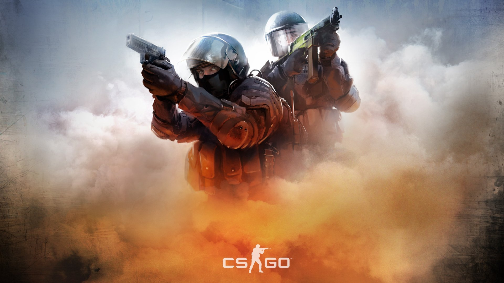

# CS2 Player Comparison
A website for comparing two players' lifetime Counter-Strike 2 (CS2) stats side-by-side, using data from Steam's Web API.

## The Problem
Currently, to compare the CS2 stats of two players, you have to open two separate tabs and compare them manually, which takes more time and system usage.

## How It Works
This website takes in one or two Steam IDs and then sends them to three backend Netlify functions to keep the API keys hidden. Two of the functions call Steam's Web API and the third Leetify's API. 
The JSONs are then read out of the responses from the API calls, where the username and specific CS2 stats are grabbed and then displayed on the website side-by-side with the other player's stats. If the Steam ID is invalid or the user profile is private a message will be displayed on the website to allow the user to understand why it did not show any stats. If just one Steam ID is entered, it will show the stats of the entered Steam ID and display nothing for the other. If the user of the Steam ID entered has never played the game before or their library is private, it will display "NaN" for all values.



## Project Goal
The goal of this project is to create a website where someone can easily compare the CS2 stats of two players.

## MVP scope
First working version:
- Take two Steam IDs through input fields
- Send each ID to a Netlify function, which calls the Steam Web API with a hdiden API key
- Pull each player's lifetime CS2 stats
- Display the basic stats for both players side-by-side
- Show a clear message when a profile is private or an ID is invalid

The MVP runs locally. Deployment, extra stats, and other features are listed under future plans.

## Future plans
Planned features, roughly ordered in priority:
- Team creation to compare groups of players
- Mobile-friendly layout
- Charts for each stat category
- Calculated stats like K/D, headshot %, and win rate
- Search by Steam profile URL or custom ID
- Leetify data for richer and per-map stats
- Dark mode
- Deployment via Netlify

## Tech stack
- Language: Javascript (Node.js for backend), HTML, and plain CSS
- Backend: Netlify Functions, which proxy requests to Steam so the API key stays on the server
- Tools: Netlify CLI for local testing, Git and GitHub for version control, curl for testing API calls
- Data source: Steam Web API, free with an API key, returns JSON, only works for public profiles
- Data storage: None for MVP, stats are fetched live for each comparison

## Setup and Running Instructions
1. Prerequisites
- Git
- Node.js (version 18+) and npm
- Netlify CLI
- Steam Web API key
- Leetify API key
2. Clone the Repository
Open a terminal and run
```bash
git clone https://github.com/TheMrStealth/CS193-Final-Project.git
cd CS193-Final-Project
```
3. Install Depenencies
Install the required packages and Netlify CLI
```bash
npm install
npm install -g netlify-cli
```
4. Configure API Keys
Create a .env file in the root directory of the project with the following:
```
STEAM_API_KEY=key
LEETIFY_API_KEY=key
```
Replace placeholder values with valid API keys
5. Deploy Project to Netlify and Add API Keys as Environment Variables
Deploy the project to Netlify. Once doing so, add both API keys as Environment Variables:
- Key: variable_name
- Secret: [X]
- Fill all Values with API key
6. Run the Website
Start the local development server
```
netlify dev
```

## Roadmap
- [X] Pull data from Steam API
- [X] Input fields for two players
- [X] Side-by-side comparison of basic stats
- [X] Add backend proxy
- [X] Add private profile and ID handling
- [X] Deploy site using Netlify
- [X] Pull data from Leetify
- [ ] Dark mode
- [ ] Mobile friendly layout
- [ ] Make charts for each category
- [ ] Team creation for stat comparison

## Demo
https://youtu.be/7VdMvFcnOJ4